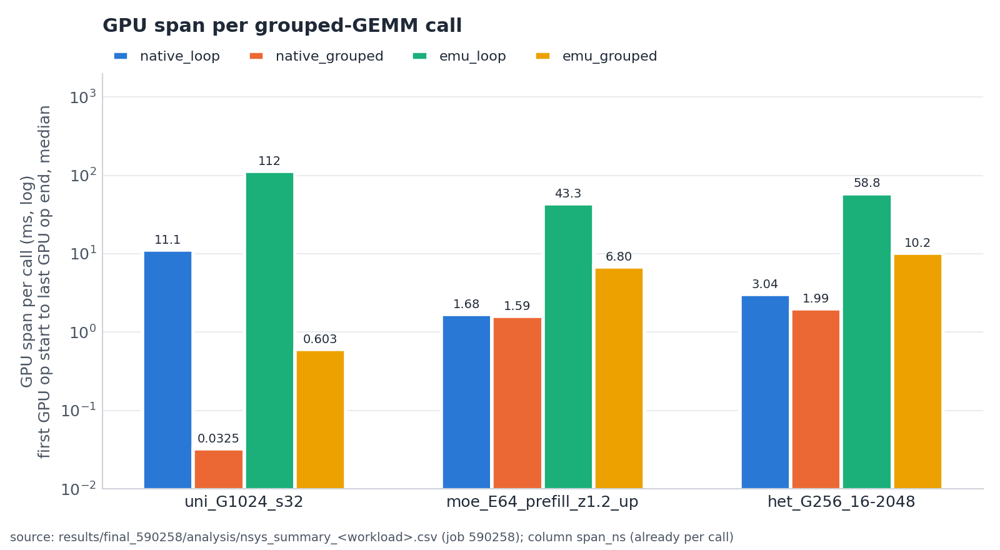
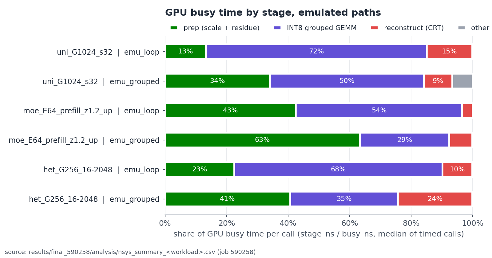
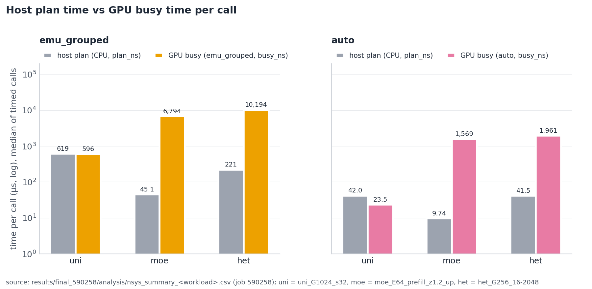
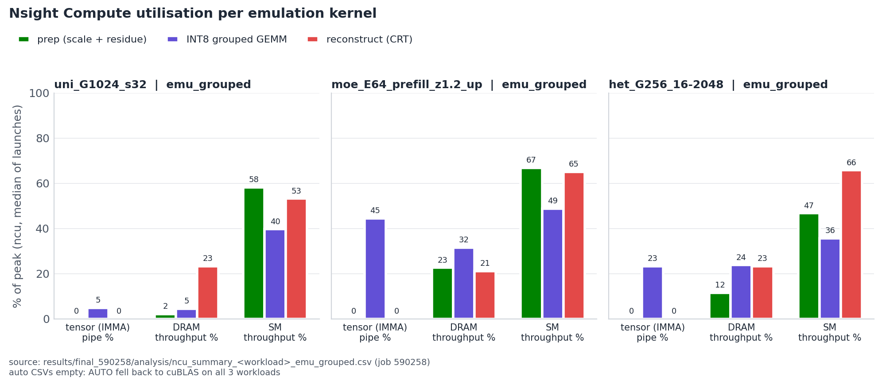
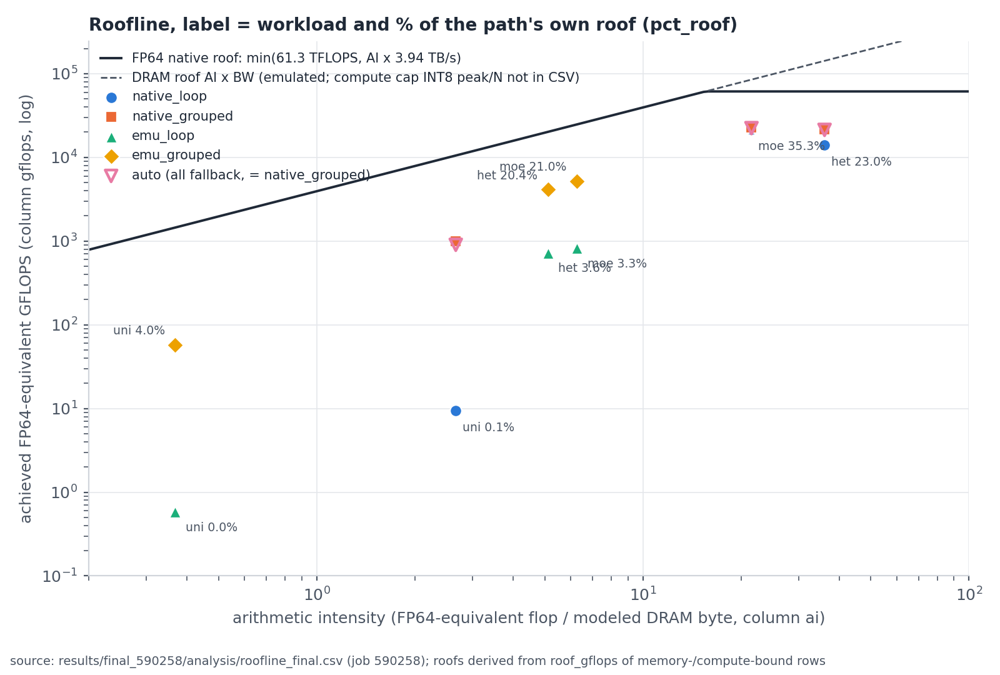

# ggemm：以 INT8 Tensor Core 模擬 FP64 的 Grouped GEMM（Ozaki scheme II）精簡報告

> 完整技術報告是 `docs/report.md`；本文每個數字都取自該報告，括號內 § 為該報告的章節，數字來源（job id／commit／路徑）逐項標在句尾或表尾。

## 摘要

我們實作了 grouped FP64 GEMM library `ggemm`：用 Ozaki scheme II [R2]（以 CRT 把 FP64 矩陣乘法拆成多個 INT8 Tensor Core GEMM）模擬 FP64，整組問題固定只用 3 個 kernel，並對每個輸出 entry 做誤差認證，認證失敗的 entry 可在同一個 kernel 內以 FP64 重算。純模擬路徑中，`EMU_GROUPED` 相對逐題 batched 模擬 `EMU_LOOP_BATCHED` 的 E2E speedup 是 geomean 4.97×（44 個 workload；job 590258）。**但在本作業唯一可用的 GPU（國網 nano4 的 H200）上，native FP64 在 44/44 個 workload 都贏，AUTO planner 全部 fallback 到 cuBLAS，沒有任何非空問題被模擬。** 本報告同時如實列出負面結果與量測假象。正確性：`test_grouped` 2955 passed / 0 failed（job 590256、590258，commit 1c39e40），compute-sanitizer 四種工具 0 errors（job 590498，commit a6b337d）。正式版本為 job 590258（`results/final_590258/`，commit 1c39e40，35 個步驟全部 PASS）。

---

## 1. 題目定義

**Grouped GEMM**：一次呼叫處理 $G$ 個互相獨立的矩陣乘法，第 $g$ 個問題是

$$C_g \leftarrow \alpha_g\, A_g B_g + \beta_g\, C_g,\qquad A_g \in \mathbb{R}^{m_g \times k_g},\ B_g \in \mathbb{R}^{k_g \times n_g}$$

$G$ 是一次呼叫的問題個數，$m, n, k$ 是矩陣維度，$\alpha, \beta$ 是純量，每題的 shape、$\alpha$、$\beta$ 都可以不同。所有 shape 相同的特例叫 Batched GEMM。這類負載常見於 MoE（每個 expert 的 token 數不同）、LoRA、block-sparse、tensor network。v1 只支援 column-major、不轉置、FP64 實數。

**為什麼用 INT8 模擬 FP64。** 新一代 GPU（題目的目標機是 RTX 5090，sm_120）FP64 很弱但 INT8 Tensor Core 很強。Ozaki scheme II 把一個 FP64 GEMM 變成 $N$ 個 INT8 GEMM（INT32 精確累加），再用中國剩餘定理（CRT, Chinese Remainder Theorem）還原。目標：在 FP64 精度下，用一個 library 把 $G$ 個異質小問題的固定成本攤掉，並讓 INT8 Tensor Core 保持忙碌。

**符號。**
- $N$：一個問題用的模數個數，$N \in [2, 20]$；$p_1, \dots, p_N$：兩兩互質、每個 $\le 256$ 的模數；$P = \prod_{l=1}^{N} p_l$。
- **plane**：一個模數對應的一份 INT8 residue 矩陣；$N$ 個模數的問題實際有 $N+1$ 份 plane，多出的一份是 abs plane（用於誤差認證）。
- $u = 2^{-53}$，$\gamma_n = \dfrac{n u}{1 - n u}$（$n$ 次累加的 FP64 誤差界）。
- $\varphi$：測資動態範圍參數，$a_{ij} = \big(U(0,1) - 0.5\big)\cdot \exp\big(\varphi \cdot \mathcal{N}(0,1)\big)$（沿用 Ozaki 論文慣例）；$\varphi$ 越大，同列／行內數值範圍越寬，模擬越難準。
- $K_p = \lceil k/32 \rceil \cdot 32$（$k$ 向上取到 32 的倍數）；**LPT**：Longest Processing Time first，工作量由大到小排序的排程法。
- **E2E**：單次 `ggemm_grouped_dgemm()` 以 cudaEvent 量到的時間（見 §5）。

---

## 2. 做法

### 2.1 Ozaki scheme II：四步驟（§2.1；依據 [R2]，程式 `src/ozaki2_numerics.cu` 自行撰寫）

1. **Scale / truncate**：$A$ 第 $i$ 列乘 $2^{s_i}$、$B$ 第 $j$ 行乘 $2^{t_j}$，向零截斷成整數 $A'$、$B'$；$s_i, t_j$ 取到使 $\sum_h \lvert A'_{ih}\rvert \lvert B'_{hj}\rvert < P/2$，CRT 還原才不會有歧義。
2. **Residue**：對每個模數 $p_l$ 取餘數 $A'_l = A' \bmod p_l$、$B'_l = B' \bmod p_l$，存成對稱範圍 int8（得 $N$ 份 plane）。
3. **INT8 GEMM**：每個模數各做 $C_l = A'_l B'_l$，INT32 精確累加（要求 $K_p \cdot 128^2 < 2^{31}$，故 $k \le 131040$）。
4. **CRT reconstruct**：由 $N$ 個餘數矩陣還原整數乘積 $X = A'B'$，再反 scale：$C_{ij} \leftarrow \alpha \cdot 2^{-(s_i + t_j)} \cdot X_{ij} + \beta\, C_{ij}$（乘 2 的冪次沒有捨入誤差）。

**Toy example**（$1\times2$ 乘 $2\times1$：$A' = [3,\ 5]$，$B' = [4,\ 2]^{\mathsf T}$，真值 $3\cdot4 + 5\cdot2 = 22$）。取 $p = (5, 7, 8)$，$P = 280$，$22 < P/2 = 140$。

| $p_l$ | $A' \bmod p_l$ | $B' \bmod p_l$ | 餘數域乘積 | $r_l$ |
|---|---|---|---|---|
| 5 | $[3,\ 0]$ | $[4,\ 2]$ | $3\cdot4 + 0\cdot2 = 12$ | $12 \bmod 5 = 2$ |
| 7 | $[3,\ 5]$ | $[4,\ 2]$ | $3\cdot4 + 5\cdot2 = 22$ | $22 \bmod 7 = 1$ |
| 8 | $[3,\ 5]$ | $[4,\ 2]$ | $3\cdot4 + 5\cdot2 = 22$ | $22 \bmod 8 = 6$ |

CRT：$M_l = P/p_l = (56, 40, 35)$；$y_l = M_l^{-1} \bmod p_l = (1, 3, 3)$（驗算：$56 \bmod 5 = 1$；$40 \bmod 7 = 5$，$5\cdot3 = 15 \equiv 1 \pmod 7$；$35 \bmod 8 = 3$，$3\cdot3 = 9 \equiv 1 \pmod 8$）。

$$S = \sum_{l} r_l M_l y_l = 2\cdot56\cdot1 + 1\cdot40\cdot3 + 6\cdot35\cdot3 = 112 + 120 + 630 = 862$$

$$Q = \operatorname{rint}(S/P) = \operatorname{rint}(862/280) = 3,\qquad X = S - QP = 862 - 3\cdot280 = 22$$

還原出 $X = 22$，與真值相同。

實作上餘數用對稱範圍（例如 mod 5 的 3 存成 −2），$S$ 以 uint64 + uint32 兩段精確累加（double-double 等級）。N 的選擇（job 590258 `logs/test_numerics_standalone.log`）：normwise 目標 1e-15 時，k = 256／1024／4096 取 N = 15，k = 16384／65536 取 N = 16；k = 131072 回傳 −1，必須 fallback。

### 2.2 三個 kernel 的 pipeline（§2.2–2.4）

```
host : planner + descriptor 打包（pinned buffer） -> 一次 descriptor H2D
GPU  : [1] oz2_prep_kernel
            整組 G 題一次 launch：算 2-norm 與 scale，
            寫出 N+1 份 INT8 residue plane
                 |
       [2] i8_grouped_persistent_kernel
            所有題、所有 plane 的 tile 排進同一個 persistent kernel：
            mma.sync.m16n8k32 s8*s8->s32、3-stage cp.async、LPT 排程
                 |
       [3] oz2_reconstruct_kernel
            整組一次 launch：CRT 還原 + 反 scale + alpha/beta
            + 逐 entry 誤差認證（必要時 FP64 重算）
```

不論 G 多大 launch 數固定是 3（job 511249：G = 16 與 G = 1024 都是 3）。重點設計：
- **Persistent grouped INT8 GEMM**（`src/int8_grouped_gemm.cu`，自寫，不用 CUTLASS）：三種 tile（128×128、64×64、32×32，共用 48 KB smem）在同一 kernel 內；host 依 tile 成本由重到輕排序（LPT），persistent CTA 從 atomic counter 取 tile，大小懸殊的題不互相等待。
- workspace 全在 `ggemm_create` 時配置，計時區內無 allocation（job 590258 `bench.csv` 308 列 `host_allocs_timed` 全為 0）。
- **Prep split-K**：沿 k 切段平行再合併，與不切 bit-exact（job 590258：S = 2、3、7、16、64 對 S = 1 皆 `0 differing buffers`）。

### 2.3 Certify-and-repair（§2.5）

normwise 誤差界無法保證 componentwise 精度（|A||B| 某 entry 因抵銷而很小時相對誤差可任意大）。因此逐 entry 認證：
1. reconstruct 時算出每個 entry 的嚴格誤差上界 $E_{ij}$；
2. 以 abs plane（$A'' = \lfloor 2^{\sigma} \lvert A\rvert \rfloor \in [0, 127]$，INT32 精確累加）算 $(\lvert A\rvert \lvert B\rvert)_{ij}$ 的嚴格下界；
3. $E_{ij}$ 夠小（滿足 $\gamma_n$ 的 componentwise 界）則通過；沒通過者依 repair mode：**OFF** 不認證；**COUNT** 保留模擬值並計數（`EMU_*` 預設，計時區內是純模擬）；**ON** 同 thread 內用 FP64 FMA 內積重算（`AUTO` 預設）；
4. 含 NaN/Inf 的列或行一律走 FP64 dot。

### 2.4 AUTO planner（§2.6，`src/planner.cpp`）

AUTO 對每題依序判斷：空問題／$k = 0$／$\alpha = 0$ 直接處理；$k > 131040$、$k \le 16$、$m n k < 32^3$ 走 native；再由 cost model 比較 $t_{\text{emu}}$ 與 $t_{\text{native}}$（參數 `bench/calib/params_nvidia_h200.json`，擬合自 `calib_510850.csv`），預測模擬較慢也走 native；其餘才模擬並逐題選 N 與 tile。同一次呼叫內相同 shape 的問題只規劃一次（per-call shape memo，commit a48eb3e），呼叫路徑無配置。

### 2.5 主要路徑（§2.9；設定依 `tests/test_grouped.cu: cfg_for`、`src/planner.cpp`）

| 路徑 | 說明 | repair | 角色 |
|---|---|---|---|
| NATIVE_LOOP | 每題一次 `cublasDgemm` | — | native baseline |
| NATIVE_GROUPED | `cublasDgemmGroupedBatched` [R16] | — | 主要 native 比較對象 |
| EMU_LOOP | 逐題模擬，每個 plane 各一次 INT8 launch（$O(G \cdot N)$ 次） | COUNT | 自寫 starter-like baseline |
| EMU_GROUPED | 整組 3 kernel（最終版） | COUNT | 純模擬，量 grouping 增益 |
| AUTO | 3 kernel + planner，可 fallback 到 native | ON | 預設路徑 |

其餘兩條：`EMU_LOOP_BATCHED`（每題 3 次 launch，自寫的 GEMMul8 風格 baseline）、`EMU_GROUPED_REUSE`（共用 operand 只做一次 prep）。另有 CUDA Graph plan/execute（`src/ggemm_graph.cu`）。

---

## 3. 結果

### 3.1 正確性（§5）

Reference 是 GPU 上的 double-double 計算，不拿 native FP64 當答案。指標為

$$\text{err/gamma} = \max_g \frac{\text{err}_{\text{cw},g}}{\gamma_{n_g}},\qquad \text{err}_{\text{cw}} = \max_{i,j} \frac{\lvert C_{ij} - C^{\text{ref}}_{ij}\rvert}{\lvert\alpha\rvert\,(\lvert A\rvert\lvert B\rvert)_{ij} + \lvert\beta\rvert\,\lvert C^{0}_{ij}\rvert}$$

其中 $C^{0}$ 是呼叫前的 $C$；$\le 1$ 代表達到 native DGEMM 自己滿足的界（Higham 2002 §3.5 [R3]）。門檻與 reference 自 5d8e2ad 起從未放寬。兩種 gate：
- **strict**（native 與 AUTO）：每個 entry err/gamma ≤ 1 且無 non-finite。
- **cert**（`EMU_*`，COUNT）：每個超過 $\gamma_n$ 的 entry 都必須被標成 uncertified，可多報、不能漏報。**cert gate 保證「不準的值一定被標出來」，不保證每個輸出都達 FP64 精度。**

| 測試 | 結果 | 來源 |
|---|---|---|
| test_grouped（7 路徑 × 4 種 $\varphi$ × $\alpha/\beta$ + edge + big-K） | **2955 passed / 0 failed** | job 590256、590258（commit 1c39e40） |
| compute-sanitizer（memcheck／racecheck／initcheck／synccheck，4 個 GPU 測試） | 全部 0 errors | job 590498（commit a6b337d，`src/` 同 1c39e40）`results/sanitize_590498/summary.md`；較早 job 590161（b56631d） |
| test_graph／test_reuse_e2e／test_planner | 63/0、54/0、1655/0 | job 590258、590258、590223（a48eb3e） |

純模擬在動態範圍寬時**不是** FP64 等級：EMU 路徑 264 列中 56 列 err/gamma > 1，最大 175.9（$\varphi = 2$），但全部通過 cert gate（job 590258 `tests.csv`）。repair ON 後 err/gamma 全部 ≤ 1（最大 0.4559），代價是 N = 15、$\varphi = 2$ 時慢 1.19–4.11 倍、最壞 5.63 倍；ON 模式平均 13.3% 的 entry 需 FP64 重算，N = 13 時部分 workload 超過 99.9%（job 590257，commit 1c39e40，`results/repair_590257/plots/repair_summary.md`）。**repair ON 是正確性安全網，不是加速手段**；$\varphi = 2$ 時加大 N 比修復划算。

### 3.2 效能（§7）

Bench set 共 44 個 workload（uniform 14、MoE 24、hetero 2、LoRA 4），$\varphi = 0.5$，warmup 5、計時 20 次取 median。

| 比較（44 個 workload 的 geomean） | 結果 |
|---|---|
| EMU_GROUPED 相對 EMU_LOOP_BATCHED（純模擬進步）[590258] | **4.97×**（uniform 18.49×、MoE 2.65×、hetero 2.23×、LoRA 3.25×；範圍 1.37×–30.93×） |
| EMU_LOOP_BATCHED 相對 EMU_LOOP [590258] | 1/0.41 ≈ 2.4× |
| starter（v0 的 EMU_LOOP）相對最終版 EMU_GROUPED [590633] | **13.86×**（範圍 2.04×–91.2×） |
| 最終版 EMU_GROUPED 相對 v0 EMU_GROUPED [590633] | 0.91×（慢 9%） |
| EMU_GROUPED 相對 NATIVE_GROUPED [590258] | **0.14×**（44/44 都比 native 慢，慢 2.38×–21.3×） |
| AUTO 相對 NATIVE_GROUPED [590258] | 1.03×（見下方說明） |

來源：[590258] = `results/final_590258/tables.md`、`bench.csv`（commit 1c39e40）；[590633] = `results/v0final_590633/compare.md`（v0 5d8e2ad 對 final e20a669，同 job、同 GPU 25a-hgpn038，交替各跑 2 次取 median）。



**圖 1**：每次 call 的 GPU span（ms，log 軸；nsys，每次 call 的 median）。在三個代表 workload 上，native_grouped 都最快；emu_grouped 的 span 比 emu_loop 短 5.8–186 倍（由圖中 span_ns 相除），但仍比 native 慢。來源：`results/final_590258/analysis/nsys_summary_<workload>.csv`（job 590258）。

- **沒有官方 starter code**（作者確認），starter 以我們第一個可用版本 v0（commit 5d8e2ad）代表；其 header 已把 `EMU_LOOP` 標為 starter-like（`git show 5d8e2ad:include/ggemm.h` 第 23 行）。
- 最終版比 v0 慢 9%：兩版 N 相同、輸出逐位元相同；最終版多做一份 abs plane（N = 15 時 INT8 工作量多 1/15 ≈ 6.7%，僅為工作量推論）與逐 entry 認證，v0 完全沒有誤差認證。abs plane 與認證各占多少沒有分開量測。
- **AUTO 不是模擬的加速**：44 列 `moduli_max` 都是 0，沒有任何非空問題被模擬（6 列 MoE decode 的 fallback 差額只是 m_e = 0 的空問題）。AUTO 相對 native 的 1.03× 來自 6 列 MoE decode 的 native_grouped 被量測順序高估（見 3.5），不是 AUTO 比 native 快。
- Graph replay 對 EMU_GROUPED 有 1.021–1.26× 收益（問題越小越大；tiny64 host issue 85.92 µs → 1.96 µs；job 590258 `logs/test_graph.log`，R = 200）。
- Operand reuse：bench 沒有共用 operand 的 workload，量到的是偵測開銷（27/44 列較慢，geomean 慢 4.2%；job 590258）；正確性 bit-exact（54/54），真正共用時的效能增益**沒有可引用的量測**。

### 3.3 Profiling 與瓶頸（§8.1、§8.4）

emu_grouped 的 GPU-busy stage 佔比（nsys）與 INT8 pipe 利用率（ncu），job 590258，`tables.md` §5 與 `analysis/nsys_summary_*.csv`：

| workload | prep % | INT8 GEMM % | reconstruct % | INT8 pipe %（ncu） |
|---|---|---|---|---|
| uni_G1024_s32 | 34.1 | 50.0 | 9.2 | 4.92 |
| moe_E64_prefill_z1.2_up | 63.4 | 29.0 | 7.5 | 44.5 |
| het_G256_16-2048 | 40.7 | 35.0 | 24.2 | 23.4 |



**圖 2**：emu_loop 與 emu_grouped 每次 call 的 GPU busy 依 stage 拆分。合併成 3 個 kernel 後，prep 佔比上升（MoE 63%），成為最大的 GPU stage。來源同圖 1。



**圖 3**：host 規劃時間（`plan_ns`）對 GPU busy（µs，log 軸）。uni_G1024_s32 上 emu_grouped 的 host plan 618.9 µs 大於 GPU busy 595.7 µs，小問題的瓶頸在 host。來源同圖 1。



**圖 4**：emu_grouped 三個 kernel 的 ncu 指標（% of peak）。INT8 tensor pipe 只在 INT8 GEMM 有值，uniform 小矩陣只有 4.9%；三個 kernel 的 DRAM 與 SM throughput 都遠低於 100%。來源：`results/final_590258/analysis/ncu_summary_<workload>_emu_grouped.csv`（job 590258）。



**圖 5**：roofline（log-log），標籤為 workload 與該路徑自身 roof 的達成率（`pct_roof`）。emu 點全是 memory-bound，emu_grouped 達 20.4%–21.0%（hetero、MoE），uniform 小矩陣只有 4.0%。CSV 推不出模擬的 compute 上限（INT8 峰值／N），所以沒有畫。來源：`results/final_590258/analysis/roofline_final.csv`（job 590258）。圖的產生方式與欄位定義見 `docs/figures/README.md`。

1. **launch 合併有效**：uni_G1024_s32 的 kernel 數由 emu_loop 的 18,432 降到 3，GPU gap 由 15.7% 降到 1.0%（job 511064，commit da18425）。
2. **小問題時 host 規劃是瓶頸**：uni_G1024_s32 的 host 649.8 µs 大於 GPU span 603.5 µs（host plan 618.9 µs；job 590258）。
3. **大問題時 prep 是最大 GPU stage**（MoE 63.4%）；emu_grouped 的 roofline 利用率 median 20.2%，44 點全是 memory-bound（job 590258）。
4. **INT8 kernel 效率不高**：INT8 tensor pipe 最高 48.0%，128 registers、每 SM 2 個 CTA、occupancy 約 25%；單一大 GEMM 只有 cuBLASLt 的 40.1%–42.2%（620.49 對 1470.04 TOPS）。但 grouped／異質情況下 persistent + LPT 比逐題呼叫 cuBLASLt 快 3.98×（random64）、7.73×（mix）、94×（small256）（job 590258 `logs/test_i8_grouped.log`）。

### 3.4 兩項由 profiling 驅動的修正（§9.6）

- **Planner per-call shape memo**（commit a48eb3e）：profile 顯示 AUTO 全部 fallback 時仍有大量 host plan 開銷（AUTO host plan 152.0 µs，job 590147）。加入 memo 後 host plan 降到 42.0 µs；uni_G4096_s32 的 AUTO 由 0.7375 ms（job 590147，b56631d）降到 0.2944 ms（job 590258），native_grouped 為 0.2697 ms；AUTO 比 native 慢 5% 以上的列數由 14/44 降到 9/44。**殘留 regression 照實保留**：小問題 uniform 上 AUTO 仍比 native 慢 6.7%–10.3%。
- **Reconstruct 計數器 warp + block 聚合**（commit 1c39e40）：原本每個 thread 對同一全域位址 atomicAdd 而被序列化。改成 warp shuffle 再 block 聚合後，192 列 EMU 的所有計數與 err_max 完全不變，時間 geomean 為原來的 0.959 倍；uncertified 多的格子最明顯，例如 het_G256 $\varphi = 2$ N = 13 COUNT 由 24.68 ms 降到 9.358 ms（job 590148 → 590257）。

### 3.5 負面結果與失敗（§10）

- **native FP64 全面勝出**（job 590258）：H200 的 FP64 很強（擬合 6.1326e13 flop/s），模擬要做約 $N+1 = 16$ 份 INT8 GEMM 加 prep 與 reconstruct，我們的 INT8 kernel 又只有 cuBLASLt 的約 40%。FP64 較弱的硬體（RTX 5090）上結果是否反轉，**沒有實測**：sm_120 雖有編譯但從未執行過；校正檔的 crossover 推估（N = 15 時方陣邊長 ≥ 4096）只是 model，未驗證且偏樂觀（INT8 擬合峰值 1676 TOPS 高於實測最大 1503.6 TOPS）。
- **AUTO 全部 fallback，ρ_budget 無法調整**：ρ_budget 掃描（job 590257、590148）全部 fallback，預設值 16 至今沒調過。
- **INT8 kernel 第二輪改動退步**：cfg0 退步 8.7%–11.7%（job 510965，logs/i8abl_510965.log），四項全部還原仍回不到第一輪，故採第一輪加安全修正。Split-K 在 cfg2 提升 31.7%–53.0% 但 cfg0 下降 2.7%–4.2%（job 511001）；獨立 split-K kernel 在 small256 慢約 31%（job 511054），故預設關閉，且經由 ggemm API 無法啟用。
- **Operand reuse 增益沒有被證明**（job 590258）；早先 10/07 影片引用的 reuse 1.015–1.079×（job 510998）因對照組也有同樣加速而作廢。
- **量測位置假象**：MoE decode 上 native_grouped 的時間取決於它在同一 process 中是否第一個被量；排在其他路徑之後時被高估約 1.6×（1.052 對 0.650 ms，共 6 列）。先前「AUTO 在 MoE decode 比 native 快 1.31×–1.62×」是假象，已刪除。根因在 cuBLAS grouped GEMM 內部，**未查明**；改用第一個量測位置的 native baseline 後模擬只會更不利（job 590956 `results/order_590956/summary.txt`；診斷 job 590953 `results/ndiag_590953/`）。
- **已知限制**：不支援轉置與 multi-GPU；Kp 上限 131040；一次呼叫最多 65535 個模擬問題（BSR block 模式 G = 93822 時所有 EMU 路徑 call_failed，AUTO 因全部 fallback 可執行；job 590258）。
- 開發中失敗的 job（例如 job 510881 有 26 failed，當時尚無 certify-and-repair）保留於 `results/`，細節見 `docs/report.md` §10.6。

---

## 4. AI 協作方式（§11）

- **工具與分工**：全程使用 Claude Code（Anthropic），以多個 agent 分工（numerics、INT8 kernel、pipeline／planner、tests／bench／scripts、CUDA Graph、應用 bench、文獻、final runner）；分工記錄在 `DESIGN.md` 的「模組與檔案歸屬」表與各原始檔檔頭的 `owner: agent-X`。
- **AI 的用途**：讀論文與整理文獻（`docs/related_work.md` 的作者與 arXiv 編號已在 10/07 人工查證並修正）、實作 library／測試／bench／SLURM 腳本、除錯、分析 profiling（`scripts/analysis/*.py`）、撰寫文件與報告初稿、口試準備（`docs/qa_prep.md`）。
- **人類的角色**：理解題目、做方向與取捨決策、審查 agent 產出、核准 SLURM job。所有 GPU 程式都在 compute node 執行，login node 只用來編譯。
- **外部程式碼：沒有複製任何外部實作。** GEMMul8 只讀過論文與演算法（`src/ozaki2_numerics.cu` 檔頭註明 "Written from the paper; no code taken from GEMMul8"），`EMU_LOOP_BATCHED` 是自寫的 GEMMul8 風格 baseline；未使用 CUTLASS（`int8_grouped_gemm.cu` 檔頭註明 "No CUTLASS"，INT8 kernel 以 inline PTX 自寫）；cuBLAS 只用於 native 路徑、fallback、校正與比較；cuBLASLt 只當 INT8 參考；NVTX 為 CUDA toolkit 附的 header-only nvtx3；repair 用自寫的 FP64 FMA 內積。演算法依據：[R1][R2][R3]。
- **可追溯性**：git 共 10 個 commit，歷史完整保留；每個 results 目錄都有 `provenance.txt`（hash 與 dirty 檔案數）。正式量測 590258（及 590256、590257）在 commit 1c39e40，dirty=6 只涉及文件檔與未追蹤項目，`src/` 乾淨。

---

## 5. 資料來源與分析

**環境（§3；job 590258 `provenance.txt`、`nvidia-smi.txt`、`nvcc.txt`）。** 國網 NCHC nano4，partition `dev`，每 job 1 GPU、12 CPU；NVIDIA H200（sm_90，132 SMs，143771 MiB）；Driver 580.65.06；CUDA 13.0（nvcc V13.0.48）；SM 最高 1980 MHz、**未鎖頻**、power limit 700 W；編譯 sm_90 與 sm_120，`-O3 -lineinfo`，C++17。**nano4 上沒有 RTX 5090，所有 job 都在 H200 上執行，本報告不對 5090 效能做任何宣稱。**

**量測方法（§6）。**
- **E2E** = `bench.csv` 的 `time_ms`：cudaEvent 量單次 `ggemm_grouped_dgemm()`，**warmup 5 次、計時 20 次取 median**（`REPS=20 WARMUP=5`）；含 host planning、descriptor 打包、descriptor H2D 與所有 kernel；所有 allocation 在計時區外。
- **GPU-busy**：nsys 量到每次呼叫的 GPU kernel 與 memop 時間，5 次 timed call 的 median；ncu duration 是 replay 下量的，只看相對大小，不與 E2E 比較。
- **Graph replay**：`test_graph` 量 200 次 `ggemm_execute_plan` 的平均。
- 同一 workload、同一份資料（固定 seed）、同一 stream；β = 0 使重複呼叫 idempotent；不 flush L2；speedup 一律是 time(base)/time(path)。
- starter 與最終版比較（job 590633）在同一 job、同一張 GPU 交替各跑 2 次取 median。
- **量測位置假象**：見 3.5；受影響的 6 列 native baseline 以 job 590956 的第一量測位置為準。

**Workload 選擇理由（§4）。** 每個家族對應一種逐題迴圈會吃虧的情境：uniform small（經典 batched BLAS，每題 $2s^3$ 從 8K 到 33M flops，可看出模擬何時划算）；MoE（m_e 偏斜且可能為 0，expert 順序用 seeded permutation 打亂以避免 in-order 排程佔便宜）；hetero（m、n、k 於 [16, 2048] log-uniform 取樣，最大與最小題差約 10^6 倍，測 tile 選擇與 LPT）；LoRA（Punica [R14]／S-LoRA 情境：n 小時方形 tile 失效，k 小時 reconstruct 成為主要成本）；另有 MoE FFN（FP64，非 LLM；Behler-Parrinello／DeePMD 類型原子勢）與 block-sparse（DBCSR／CP2K 類線性尺度電子結構）兩個應用層 workload。動態範圍 $\varphi = 0.5$（效能）與 $\varphi \in \{0, 0.5, 1, 2\}$（正確性）。

**如何重現（§12）。** 所有指令用 sbatch 送出，不要在 login node 跑 GPU 程式；預設 `-A GOV114009 -p dev --gpus-per-node=1 --cpus-per-task=12`，可 `sbatch -A <account>` 覆蓋。

```bash
mkdir -p results logs
sbatch scripts/final/run_final.slurm          # build -> 全部測試 -> bench -> 應用 -> nsys/ncu -> tables.md
#   產出 results/final_<jobid>/{summary.md,tables.md,bench.csv,tests.csv,analysis/}
#   旋鈕：REPS=20 WARMUP=5 PHI=0.5 BENCH_SET=bench
sbatch scripts/repair_sweep.slurm             # COUNT/ON 與 rho sweep
sbatch scripts/sanitize.slurm                 # compute-sanitizer
sbatch scripts/final/starter_vs_final.slurm   # starter(v0=5d8e2ad) 對最終版
```

**數字來源總覽。** 每個數字都可追溯到 `results/`、`logs/` 的實測檔案與 SLURM job id：

| job | 內容 | commit | 路徑 |
|---|---|---|---|
| 590258 | 正式 final matrix（35 步 PASS） | 1c39e40 | `results/final_590258/` |
| 590633 | starter(v0) 對最終版 | 5d8e2ad／e20a669 | `results/v0final_590633/compare.md` |
| 590256 | test_grouped | 1c39e40 | `results/test_590256/` |
| 590257 | repair sweep | 1c39e40 | `results/repair_590257/` |
| 590147／590148 | 修正前對照（final／repair） | b56631d | `results/final_590147/`、`results/repair_590148/` |
| 590224 | 只加 shape memo | a48eb3e | `results/final_590224/` |
| 590223 | planner unit | a48eb3e | `results/planner_unit_590223/test_planner.log` |
| 590498／590161 | sanitizer（最終／較早） | a6b337d／b56631d | `results/sanitize_590498/`、`sanitize_590161/` |
| 590956／590953 | 量測順序診斷 | c8463fc | `results/order_590956/`、`results/ndiag_590953/` |
| 511249／511064 | launch 數與 memcheck／nsys-ncu | b56631d／da18425 | `results/test_511249/`、`results/prof_511064/analysis/` |
| 510965／511001／511054 | INT8 ablation／split-K | — | `logs/i8abl_510965.log`、`logs/i8cfg2_511001.log`、`logs/i8cfg2sep_511054.log` |
| 510850 | 校正 | — | `bench/calib/params_nvidia_h200.json` |

完整逐 workload 表、ablation 細節、失敗 job 清單與數字來源總表（附錄 A）見 `docs/report.md`。

---

## 參考文獻

書目資訊取自 `docs/related_work.md`（2026-10-07 編譯並查證）；其中標「未確認」者保留原註記。`[R1]–[R3]` 是 `docs/report.md` 直接引用的演算法依據；`[R4]` 起是 related work。

**演算法依據（report.md §1、§2.1、§5.1、§11 引用）**
- [R1] Katsuhisa Ozaki, Takeshi Ogita, Shin'ichi Oishi, Siegfried M. Rump. *Error-free transformations of matrix multiplication by using fast routines of matrix multiplication and its applications.* Numerical Algorithms, Vol. 59, Issue 1, pp. 95–118, 2012. DOI: 10.1007/s11075-011-9478-1。（原檔註記：標題／卷／頁已查證，DOI 未能獨立解析驗證。）
- [R2] Katsuhisa Ozaki, Yuki Uchino, Toshiyuki Imamura. *Ozaki Scheme II: A GEMM-oriented emulation of floating-point matrix multiplication using an integer modular technique.* arXiv:2504.08009（2025-04-10 投稿，v1；related_work 摘要表記 2504.08009v3）。CRT 模運算分解，GH200 上 14 moduli 達 71.1 TF/s（cuBLAS DGEMM 60.9 TF/s）。
- [R3] N. J. Higham, 2002, §3.5（誤差界 $\gamma_n$ 的定義依據；report.md 僅以「Higham 2002 §3.5」引用，repo 內沒有更完整的書目，此處不補寫未查證資訊）。

**Batched／Grouped GEMM 相關工作**
- [R4] A. Abdelfattah, A. Haidar, S. Tomov, J. Dongarra. *Performance, Design, and Autotuning of Batched GEMM for GPUs.* ISC High Performance 2016, Frankfurt（Springer；icl-utk-945-2016）。
- [R5] I. Masliah, A. Abdelfattah, A. Haidar, S. Tomov, M. Baboulin, J. Falcou, J. Dongarra. *High-Performance Matrix-Matrix Multiplications of Very Small Matrices.* Euro-Par 2016, Grenoble, pp. 659–671（Springer）。
- [R6] J. Dongarra, S. Hammarling, N. J. Higham, S. D. Relton, P. Valero-Lara, M. Zounon. *The Design and Performance of Batched BLAS on Modern High-Performance Computing Systems.* Procedia Computer Science, ICCS 2017, Zurich。
- [R7] A. Abdelfattah, A. Haidar, S. Tomov, J. Dongarra. *Novel HPC Techniques to Batch Execution of Many Variable Size BLAS Computations on GPUs.* ICS '17, Chicago. DOI: 10.1145/3079079.3079103。
- [R8] A. Abdelfattah, S. Tomov, J. Dongarra. *Fast Batched Matrix Multiplication for Small Sizes using Half Precision Arithmetic on GPUs.* IPDPS 2019, Rio de Janeiro（icl-utk-1236-2019）。
- [R9] I. Masliah et al. *Algorithms and optimization techniques for high-performance matrix-matrix multiplications of very small matrices.* Parallel Computing, Vol. 81, Jan 2019。
- [R10] A. Abdelfattah, T. Costa, J. Dongarra, M. Gates, A. Haidar, S. Hammarling, N. J. Higham, J. Kurzak, P. Luszczek, S. Tomov, M. Zounon. *A Set of Batched Basic Linear Algebra Subprograms and LAPACK Routines.* ACM TOMS, Vol. 47, Issue 3, June 2021。
- [R11] X. Li, Y. Liang, S. Yan, L. Jia, Y. Li. *A Coordinated Tiling and Batching Framework for Efficient GEMM on GPUs.* PPoPP 2019, Washington DC. DOI: 10.1145/3293883.3295734。
- [R12] M. Osama, D. Merrill, C. Cecka, M. Garland, J. D. Owens. *Stream-K: Work-centric Parallel Decomposition for Dense Matrix-Matrix Multiplication on the GPU.* PPoPP 2023, Montreal（poster；preprint arXiv:2301.03598）。
- [R13] Y. Zhang, L. Lu, Z. Yang, Z. Liang, S. Suo. *A load-balanced acceleration method for small and irregular batch matrix multiplication on GPU.* Journal of Systems Architecture, Vol. 160, March 2025. DOI: 10.1016/j.sysarc.2025.103341。（原檔標記：資訊不完整，未能直接開啟頁面。）
- [R14] L. Chen, Z. Ye, Y. Wu, D. Zhuo, L. Ceze, A. Krishnamurthy. *Punica: Multi-Tenant LoRA Serving.* MLSys 2024。
- [R15] Y. Li et al. (16 位作者，全名見 related_work.md). *Static Batching of Irregular Workloads on GPUs: Framework and Application to Efficient MoE Model Inference.* arXiv:2501.16103（2025-01-27）。
- [R16] NVIDIA Developer Blog (Babak Hejazi). *Introducing Grouped GEMM APIs in cuBLAS and More Performance Updates.* cuBLAS 12.5, 2024-05-09. https://developer.nvidia.com/blog/introducing-grouped-gemm-apis-in-cublas-and-more-performance-updates ；官方文件 https://docs.nvidia.com/cuda/archive/12.5.0/pdf/CUBLAS_Library.pdf 。
- [R17] Y. Shi, U. N. Niranjan, A. Anandkumar, C. Cecka. *Tensor Contractions with Extended BLAS Kernels on CPU and GPU.* HiPC 2016, pp. 193–202. arXiv:1606.05696。
- [R18] D. E. Tanner. *Tensile: Auto-tuning GPU Assembly for All Problem Sizes.* iWAPT@IPDPS 2018（未確認出版，僅由搜尋結果間接證實）；https://github.com/ROCmSoftwarePlatform/Tensile 。
- [R19] T. Gale et al. *MegaBlocks: Efficient Sparse Training with Mixture-of-Experts.* MLSys 2023. arXiv:2211.15841。

**FP64 emulation 相關進展**
- [R20] A. Schwarz, A. Anders, C. Brower, H. Bayraktar, J. Gunnels, K. Clark, R. G. Xu, S. Rodriguez, S. Cayrols, P. Tabaszewski, V. Podlozhnyuk (NVIDIA). *Guaranteed DGEMM Accuracy While Using Reduced Precision Tensor Cores Through Extensions of the Ozaki Scheme.* arXiv:2511.13778（2025-11；SCA/HPCAsia 2026 預定發表）。
- [R21] D. Lu, A. Maeder, M. Luisier, A. N. Ziogas. *EmuGEMM: Fused Tensor Core Kernels for Precision Emulation in Matrix Multiplication.* arXiv:2606.25453（v1 2026-06-24，v2 2026-10-05）。
- [R22] *Performance Enhancement of the Ozaki Scheme*（integer matrix multiplication unit 上的改進）. arXiv:2409.13313（2024-09）。
- [R23] *Improved Scaling for Fast Mode of Ozaki Scheme II.* arXiv:2606.29129（2026-06）。
- [R24] S. Matsuoka. *Ozaki 2.5: Engineering the Deconstruction Path of fp64-Emulated Dense Matrix Multiplication on FP8 Tensor Cores.* arXiv:2609.09095（2026-09-08）。

**僅出現名稱、repo 內無書目的外部項目**：GEMMul8（Ozaki scheme II 的參考實作，僅讀論文與演算法）、CUTLASS（未使用）、cuBLAS／cuBLASLt（CUDA 13.0 toolkit）、NVTX（nvtx3）、S-LoRA、DBCSR／CP2K、Behler-Parrinello／DeePMD（僅作 workload 情境說明）。
